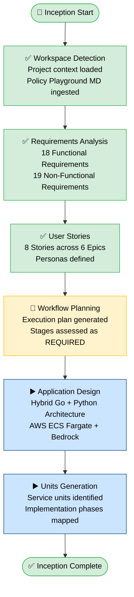

# Execution Plan — Mermaid Diagram



## Text Fallback

```
Text-based diagram fallback:

  %%{init: {'theme': 'base', 'themeVariables': {'primaryColor': '#4a90d9', 'primaryTextColor': '#000000', 'primaryBorderColor': '#2c5f8a', 'lineColor': '#333333', 'secondaryColor': '#f0f4fa', 'tertiaryColor': '#ffffff', 'background': '#ffffff', 'mainBkg': '#ffffff', 'nodeBorder': '#2c5f8a', 'clusterBkg': '#f8f9fa', 'titleColor': '#000000', 'edgeLabelBackground': '#ffffff'}}}%%
  Diagram type: flowchart TD
  A([🚀 Inception Start]) --> B
  B[✅ Workspace Detection\nProject context loaded\nPolicy Playground MD ingested]
  B --> C
  C[✅ Requirements Analysis\n18 Functional Requirements\n19 Non-Functional Requirements]
  C --> D
  D[✅ User Stories\n8 Stories across 6 Epics\nPersonas defined]
  D --> E
  E[🔄 Workflow Planning\nExecution plan generated\nStages assessed as REQUIRED]
  E --> F
  F[▶️ Application Design\nHybrid Go + Python Architecture\nAWS ECS Fargate + Bedrock]
  F --> G
  G[▶️ Units Generation\nService units identified\nImplementation phases mapped]
  G --> H
  H([✅ Inception Complete])
  style A fill:#d4edda,stroke:#28a745,color:#000000
  style B fill:#d4edda,stroke:#28a745,color:#000000
  style C fill:#d4edda,stroke:#28a745,color:#000000
  style D fill:#d4edda,stroke:#28a745,color:#000000
  style E fill:#fff3cd,stroke:#ffc107,color:#000000
  style F fill:#cce5ff,stroke:#004085,color:#000000
  style G fill:#cce5ff,stroke:#004085,color:#000000
  style H fill:#d4edda,stroke:#28a745,color:#000000
```
